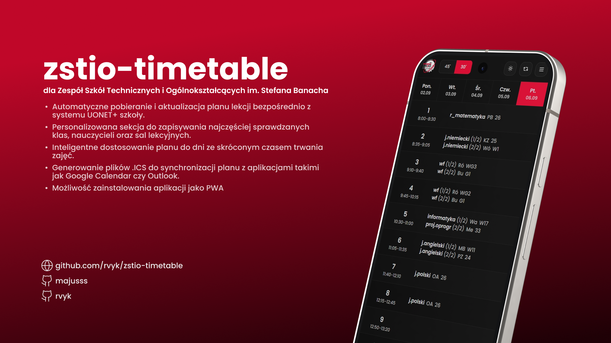

Polska wersja / [English version](README.md)

# ✨ ZSTiO Timetable 🚀

Nowoczesna i odświeżona aplikacja planu lekcji dla Zespołu Szkół Technicznych i Ogólnokształcących (ZSTiO), stworzona z wykorzystaniem najnowszych technologii webowych. Ta intuicyjna aplikacja ułatwia dostęp do planów zajęć, oferując bezproblemową obsługę dla uczniów, nauczycieli i pracowników.

## 🚀 Najważniejsze Funkcje

- **Uniwersalna Kompatybilność 🌍:** Przystosowana do każdej szkoły korzystającej z planów UONET. Wystarczy skonfigurować zmienną środowiskową `NEXT_PUBLIC_TIMETABLE_URL`.
- **Układ Dopasowany do Ekranu 🗓️:** Widok dzienny na telefonie, tabela całego tygodnia na desktopie.
- **Ulubione ⭐:** Zapisz najczęściej przeglądane klasy, nauczycieli i sale, a jeden z nich ustaw jako plan domyślny otwierany po wejściu na stronę.
- **Wygodne Wyszukiwanie Wolnych Sal 🔎:** Szybko sprawdź dostępne sale według dnia i numeru lekcji.
- **Inteligentne Skrócone Lekcje ⏱️:** Automatyczna adaptacja planu do skróconych godzin lekcyjnych.
- **Podgląd Trwającej Lekcji ⏳:** Widzisz aktualną lekcję, trwającą przerwę i pozostały czas.
- **Subskrypcja Kalendarza (webcal) 📅:** Zasubskrybuj aktualizowany na bieżąco kanał `webcal://` w aplikacji kalendarza lub Google Calendar — z automatycznym pominięciem świąt i ferii.
- **Publiczne REST API 🔌:** JSON-owe API tylko do odczytu pod `/api/v1`, ze specyfikacją OpenAPI 3.1 i interaktywną dokumentacją pod `/api/v1/docs`.
- **Wykrywanie Zmian w Planie 🔔:** Opcjonalny watcher wykrywa zmiany w planie i wysyła je na webhooka Discorda.
- **Aktualności Szkolne 📰:** Opcjonalnie pobiera najnowsze wpisy ze strony szkoły i pokazuje je jako powiadomienie, które można zamknąć.
- **Wielojęzyczny Interfejs 🌐:** Pełne tłumaczenia polskie i ukraińskie.
- **Nawigacja Klawiaturą ⌨️:** Poruszaj się po dniach i lekcjach bez użycia myszki.
- **Wersja do Druku 🖨️:** Osobny widok wydruku dla czytelnej kopii papierowej.
- **Responsywny Interfejs na Wszystkich Urządzeniach 📱💻:** Przeglądaj plan lekcji z dowolnego urządzenia dzięki spójnemu i intuicyjnemu interfejsowi.
- **Elegancki Tryb Ciemny 🌙:** Przełączaj się między jasnym i ciemnym motywem dla komfortu użytkowania.
- **Dostęp Offline dzięki PWA 🔌:** Zainstaluj aplikację jako PWA (Progressive Web App) dla szybszego ładowania i pracy offline.
- **Zaawansowane Śledzenie Błędów (Sentry) ⚠️:** Integracja z Sentry umożliwia monitorowanie błędów i stabilność działania.
- **Łatwe Wdrażanie z Dockerem 🐳:** Dzięki dołączonemu plikowi Dockerfile wdrażanie jest szybkie i gwarantuje spójność środowiska.

## 💻 Wykorzystane technologie

- **Next.js 16 (App Router, Turbopack):** Framework Reacta do aplikacji produkcyjnych.
- **React 19:** Z komponentami serwerowymi i Server Actions.
- **TypeScript:** Zapewnia typowanie i lepsze doświadczenia dla programistów.
- **Tailwind CSS v4:** Szybkie tworzenie nowoczesnych interfejsów użytkownika.
- **shadcn/ui:** Piękne i dostępne komponenty interfejsu.
- **@majusss/timetable-parser:** Wydajne przetwarzanie danych i parsing.
- **Zustand:** Lekki i wydajny system zarządzania stanem.
- **Next Themes:** Proste przełączanie motywów.
- **Serwist:** Service worker i cache PWA.
- **ics:** Generowanie kalendarza w formacie ICS.
- **@t3-oss/env-nextjs + Zod:** Walidowane, typowane zmienne środowiskowe.
- **Vercel Analytics:** Opcjonalna analityka użycia.
- **Sentry:** Śledzenie błędów i monitorowanie wydajności w czasie rzeczywistym.
- **Docker:** Konteneryzacja ułatwiająca wdrożenie.

## 🔌 Publiczne API

Pod `/api/v1` działa JSON-owe API tylko do odczytu. Nie wymaga klucza, CORS jest otwarty dla każdej domeny, a dane ze szkoły są cache'owane przez 15 minut jak reszta aplikacji. Odpowiedzi mają `ETag`, więc odpytywanie z `If-None-Match` dostaje tanie `304`. Pełna dokumentacja powstaje ze specyfikacji OpenAPI 3.1, wersja interaktywna jest pod `/api/v1/docs`.

`type` to `class`, `teacher` albo `room`, `id` to numeryczny identyfikator Optivum z `/api/v1/timetables`. `day` przyjmuje `0`-`6` (od poniedziałku), angielskie nazwy dni, `today` i `tomorrow`. Endpointy planu, dnia, `now` i `hours` przyjmują też `hours=short` albo `hours=custom&shortenFrom=N` dla skróconych lekcji, a każdy endpoint planu przyjmuje `group=1/2`, który zostawia jedną grupę i lekcje całej klasy. `at` przyjmuje datę ISO z offsetem albo lokalny czas warszawski `YYYY-MM-DDTHH:MM`. `/changes` wymaga watchera planu z trwałym snapshotem, więc na Vercelu jest puste.

| Endpoint                                        | Opis                                                |
| ----------------------------------------------- | --------------------------------------------------- |
| `GET /api/v1`                                   | Indeks wszystkich endpointów                        |
| `GET /api/v1/docs`                              | Interaktywna dokumentacja                           |
| `GET /api/v1/openapi.json`                      | Specyfikacja OpenAPI 3.1                            |
| `GET /api/v1/status`                            | Stan źródła i daty planu                            |
| `GET /api/v1/timetables?type=&q=`               | Wszystkie klasy, nauczyciele i sale, z filtrowaniem |
| `GET /api/v1/search?q=&limit=`                  | Wyszukiwanie po nazwie z rankingiem                 |
| `GET /api/v1/timetables/{type}/{id}`            | Cały tydzień z godzinami lekcji                     |
| `GET /api/v1/timetables/{type}/{id}/week?from=` | Tydzień z datami i zaznaczonymi dniami wolnymi      |
| `GET /api/v1/timetables/{type}/{id}/next?at=`   | Następna lekcja, z pominięciem weekendów i świąt    |
| `GET /api/v1/timetables/{type}/{id}/days/{day}` | Jeden dzień                                         |
| `GET /api/v1/timetables/{type}/{id}/now?at=`    | Bieżąca i następna lekcja (czas warszawski)         |
| `GET /api/v1/timetables/{type}/{id}/subjects`   | Przedmioty z liczbą godzin w tygodniu               |
| `GET /api/v1/timetables/{type}/{id}/calendar`   | Kanał iCalendar                                     |
| `GET /api/v1/hours`                             | Dzwonki                                             |
| `GET /api/v1/free-rooms?day=&lesson=`           | Wolne sale na dzień i lekcję                        |
| `GET /api/v1/free-rooms/now?at=`                | Sale wolne na bieżącej lekcji                       |
| `GET /api/v1/changes?type=&id=`                 | Ostatnie zmiany w planie wykryte przez watcher      |
| `GET /api/v1/news?limit=`                       | Najnowsze wpisy ze strony szkoły                    |
| `GET /api/v1/days-off?from=&weeks=&weekends=`   | Święta i przerwy w nauce                            |

```bash
curl "https://plan.zstiojar.edu.pl/api/v1/search?q=4tp"
curl "https://plan.zstiojar.edu.pl/api/v1/timetables/class/27/next?group=1/2"
```

Błędy zawsze mają postać `{"error": {"status": 404, "code": "not_found", "message": "..."}}`.

## Instalacja i Konfiguracja

1. **Sklonuj repozytorium:**

   ```bash
   git clone https://github.com/rvyk/zstio-timetable.git
   cd zstio-timetable
   ```

2. **Zainstaluj zależności:**

   ```bash
   pnpm install
   ```

3. **Skonfiguruj zmienne środowiskowe:**

   Utwórz plik `.env.local` na podstawie `.env.example` i ustaw:
   - **`NEXT_PUBLIC_TIMETABLE_URL` (wymagane):** URL do planu lekcji Twojej szkoły (UONET).
   - **`NEXT_PUBLIC_APP_URL` (wymagane):** Podstawowy URL aplikacji.
   - **`NEXT_PUBLIC_SCHOOL_NEWS_URL` (opcjonalne):** Endpoint REST WordPressa używany do powiadomień o aktualnościach szkolnych.
   - **`NEXT_PUBLIC_ALT_TIMETABLE_URL` (opcjonalne):** Link do alternatywnego (nieoficjalnego) planu; przycisk jest ukryty, gdy zmienna nie jest ustawiona lub adres nie odpowiada.
   - **`NEXT_PUBLIC_DISABLE_ANALYTICS` (opcjonalne):** Ustaw na `"true"` poza Vercelem, aby pominąć skrypt Vercel Analytics.
   - **`BUILD_STANDALONE` (opcjonalne):** Ustaw na `"true"`, aby zbudować Next.js w trybie standalone (używane przez Dockerfile).
   - **`DISCORD_WEBHOOK_URL` (opcjonalne):** Webhook Discorda do powiadomień o zmianach w planie. Bez niego watcher jest całkowicie wyłączony.
   - **`PLAN_WATCH_INTERVAL_MINUTES` (opcjonalne):** Uruchamia watcher w procesie aplikacji co N minut (zalecane 15+; ignorowane na Vercelu).
   - **`PLAN_WATCH_SECRET` (opcjonalne):** Zabezpiecza `GET /api/plan-watch`, czyli ręczne wywołanie tego samego sprawdzenia, oraz `POST /api/revalidate`.
   - **`REVALIDATE_URL` (opcjonalne):** Adres drugiego deploymentu (np. Vercel). Po wykryciu zmiany watcher uderza w `POST /api/revalidate` pod tym adresem, żeby wyczyścić tam cache planów.
   - **`PLAN_SNAPSHOT_PATH` (opcjonalne):** Miejsce zapisu poprzedniego snapshotu planu (domyślnie `./data/plan-snapshots.json`). Wskaż zamontowany wolumen, aby przetrwał restarty.
   - **`SENTRY_AUTH_TOKEN` (opcjonalne):** Token autoryzacji Sentry.

4. **Serwer Deweloperski:**

   ```bash
   pnpm dev
   ```

   Otwórz aplikację w przeglądarce pod adresem `http://localhost:3000`.

5. **Budowa Produkcyjna (Zalecany Docker):**

   ```bash
   docker build -t zstio-timetable-docker .
   docker run -p 3000:3000 zstio-timetable-docker
   ```

6. **Budowa Produkcyjna (Alternatywa):**

   ```bash
   pnpm build
   pnpm start
   ```

## Współtworzenie

Wszelkie wkłady są mile widziane! Otwórz zgłoszenie lub prześlij pull request.

## Licencja

Licencja MIT. Zobacz plik [LICENSE](LICENSE) po szczegóły.
